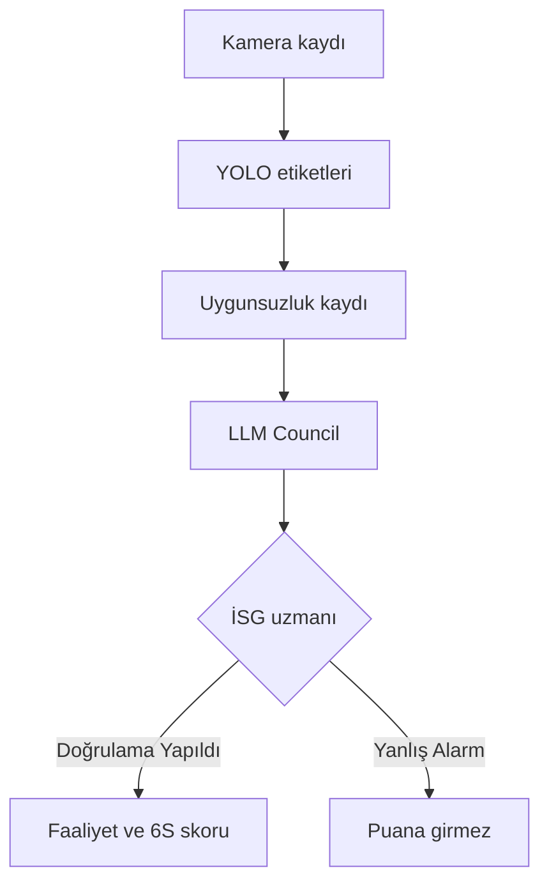
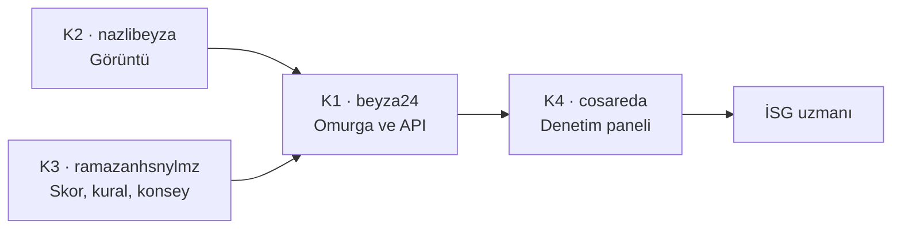

# 6S-VISION AI

Yapay zekâ destekli fabrika düzeni ve iş güvenliği denetim paneli.  
**Yapay zekâ görür, insan karar verir.**

ICAAD 2026 · AI-Deathon · Selçuk Üniversitesi

## Ekip

| Kişi | GitHub | Rol |
|------|--------|-----|
| K1 | [@beyza24](https://github.com/beyza24) | Omurga + koordinatör (merge) |
| K2 | [@nazlibeyza](https://github.com/nazlibeyza) | Görüntü / tespit |
| K3 | [@ramazanhsnylmz](https://github.com/ramazanhsnylmz) | 6S skor + kurallar + AI açıklama |
| K4 | [@cosareda](https://github.com/cosareda) | Denetim paneli UI |

Süreç: `AGENTS.md` · Plan: `docs/PLAN.md` · Promptlar: `docs/BASLANGIC-PROMPTLARI.md`

## Hızlı başlangıç

```bash
gh repo clone beyza24/6s-vision-ai
cd 6s-vision-ai
python -m venv .venv
.venv\Scripts\activate          # Windows
pip install -r requirements.txt
copy .env.example .env
uvicorn app.main:app --reload --port 8000
```

Aç: http://127.0.0.1:8000/ · API docs: http://127.0.0.1:8000/docs

```bash
python -m pytest -q
```

## Hakem demosu (2 dk)

1. **Demo: yeni tespit** → baretsiz çalışan + **LLM Council** oyları  
2. Konsey sentezi / muhalefet → AI açıklama  
3. **Doğrula** → **Faaliyet ata & çöz** → skor güncellenir  
4. İstersen **Yanlış Alarm** ile insan kapısını göster  

## LLM Council

Kural ihlalinde tek modele güvenilmez. Birden fazla LLM bağımsız oy verir; başkan sentezler.  
Son karar insandadır. Detay: `app/council/README.md`.

## Problem (kısa)

6S/İSG turları periyodik; kameralar var ama sürekli izleyen yok. İhlaller geç fark edilir.

## Çözüm akışı

Gözlemle → Tespit et → **LLM Council** → İnsan doğrular → Düzelt ve izle

## Akış şeması

### Çalışma mantığı

Kamera kaydı etiketlenir, eksiklik bir olaya yazılır, konsey önerir ve son kararı iş güvenliği uzmanı verir.



### Görev dağılımı

Dört kişi aynı repoda çalışır. Görüntü ve konsey omurgaya bağlanır. Panel bu API’yi gösterir. Birleştirmeyi K1 yapar.



## Yapılan iş

6S-VISION AI, fabrika kamerasındaki düzen ve iş güvenliği uygunsuzluklarını tek panelde toplayan bir denetim sistemidir. Kayıt izlenir, eksiklik bir olaya yazılır, birden fazla dil modeli aynı olayı ayrı ayrı oylar ve son kararı iş güvenliği uzmanı verir. Uzmanın kararı 6S skoruna ve haftalık rapora yansır.

Bu repoda omurga, görüntü arayüzü, skor, kural taslağı, LLM Council ve denetim paneli aynı akışta birleşir. Test kaydında YOLO etiketleri videonun üstüne çizilir. Kayıtta süren “KKE yok” tespiti listede bir kez görünür; süre uzarsa panelde “Güvenlik açığı var” uyarısı çıkar. **Konseyi çalıştır** canlı modellere gider. **Doğrulama Yapıldı** ve **Yanlış Alarm** konseyden sonra da kullanılabilir.

Ayrıntılı anlatım: [docs/PROJE-RAPORU.md](docs/PROJE-RAPORU.md) · indirilebilir kopya: [docs/PROJE-RAPORU.pdf](docs/PROJE-RAPORU.pdf)

### Yazılım dilleri

| Katman | Dil ve araç | Nerede |
|--------|-------------|--------|
| Arayüz | HTML, CSS, JavaScript | `frontend/` |
| Sunucu ve API | Python, FastAPI, Pydantic, Uvicorn | `app/` |
| Test | Python, pytest | `tests/` |
| Sürekli denetim | GitHub Actions (YAML) | `.github/workflows/ci.yml` |
| Görüntü modeli | Python, Ultralytics YOLO, OpenCV | `scripts/export_yolo_boxes.py`, `models/best.pt` |
| Konsey çağrısı | Python, HTTP istemcisi, OpenAI uyumlu sohbet API | `app/council/` |

Arayüzde derleme adımı yoktur. Tarayıcı HTML, CSS ve JavaScript dosyalarını doğrudan açar. Sunucu bu dosyaları statik olarak yayınlar ve `/api` uçlarını aynı uygulamada sunar.

### Proje nasıl yapıldı

1. Önce tek sayfalık panel prototipi yazıldı (`prototype/6s-vision-ai.html`).
2. Dört kişilik ekip aynı repoda, dosya sahipliği ve çekme isteği ile ilerledi. Omurga, görüntü, skor/konsey ve panel ayrı klasörlerde durur.
3. Olay kaydı için ortak şema ve bellek içi depo kuruldu. Sağlık, liste, doğrulama, yanlış alarm, atama, skor ve kural uçları buna bağlandı.
4. Tespit tarafı bir arayüzle ayrıldı. Anahtarsız demo için sabit örnekler, panel demosu için eğitilmiş YOLO ağırlığı kullanıldı.
5. Test videosunun her karesi modelden geçirildi. Kutu koordinatları JSON olarak saklandı. Tarayıcı videoyu oynatırken bu kutuları tuval üzerine çizer; model tarayıcıda çalışmaz.
6. Kural ihlali kararı tek modele bırakılmadı. LLM Council her üyeden ayrı oy alır, başkan oyları birleştirir, panel gerekçe ve muhalefeti gösterir.
7. Uzman doğrular, yanlış alarm der veya faaliyet atar. Skor, açık ve çözülen kayıtlardan hesaplanır. Haftalık rapor ekrandan yazdırılır.

Video dosyası ve model ağırlığı boyut sınırı nedeniyle git geçmişine konmaz. Panel, bu dosyalar yerelde dururken aynı akışı çalıştırır.
